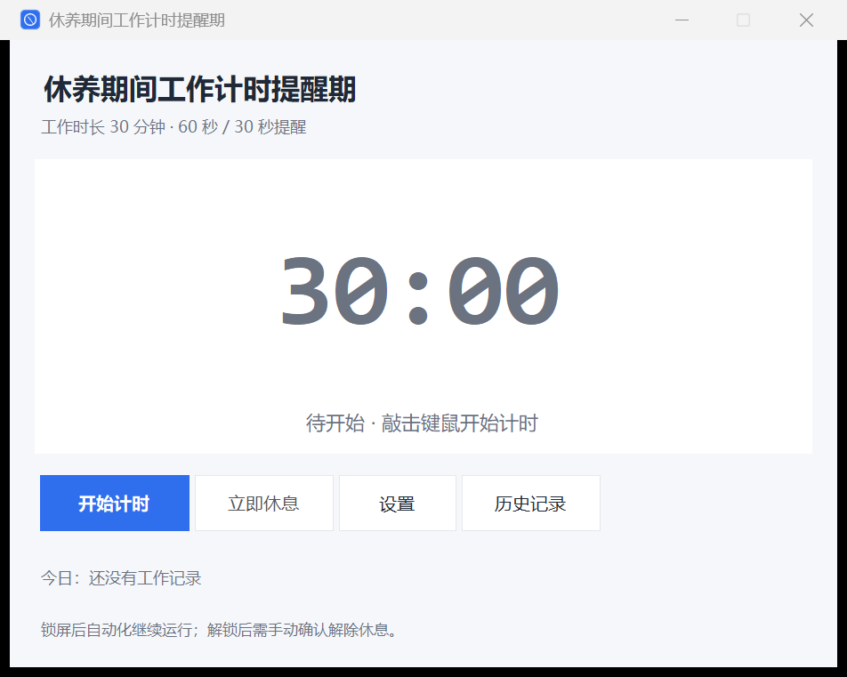
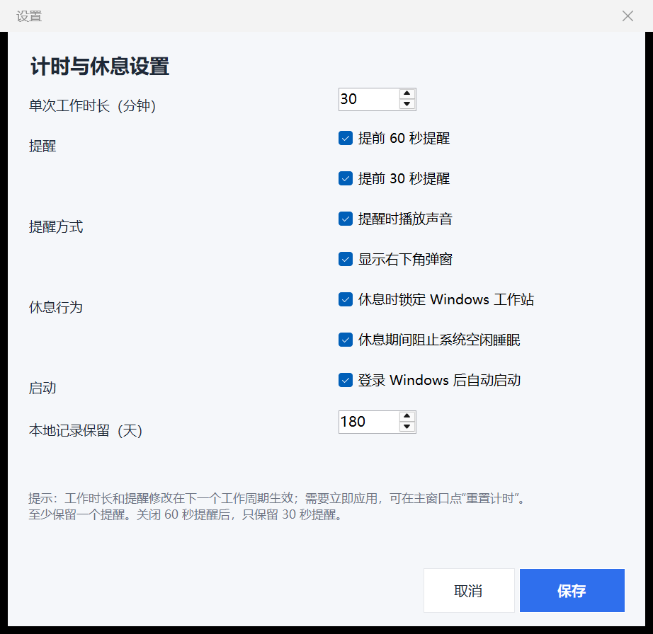
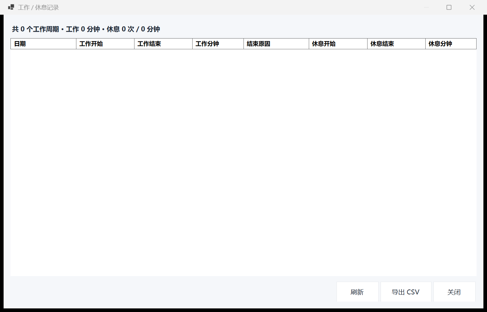
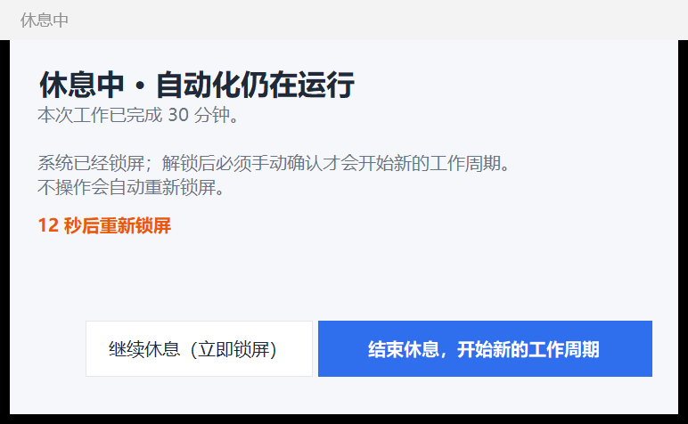

# 验收记录 — v0.1.0（已验收）

日期：2026-10-19
环境：Windows 11 26200 / .NET 8.0.24 Desktop Runtime / 2560×1600 @ 150% DPI
交付默认：30 分钟、60/30 秒提醒、锁屏、防休眠、本地记录
真机验收临时配置：2 分钟、60/30 秒提醒、`lockOnRest=true`、`autoStart=false`。

## 1. 自动化与构建

| 项目 | 结果 |
|---|---|
| `dotnet test`（25 个用例） | 通过 |
| GitHub Actions `ci` | build / test / publish 通过 |
| 发布单文件 exe | [v0.1.0](https://github.com/Jiqiren87/recuperation-work-timer/releases/tag/v0.1.0) 可下载；本机与 CI 产物均可启动 |

## 2. 真机验收

| 项目 | 观察结果 |
|---|---|
| 程序启动 | 托盘与主窗口创建；输入钩子和会话监听均成功注册 |
| 物理输入启动 | 12:58:52 真实键鼠触发 `cycle.start`（`reason=human-input`） |
| 注入输入过滤 | 用户保持不动时发送 `SendInput` 鼠标移动（返回 1），之后 14 秒内没有 `cycle.start`；直到 12:58:52 物理输入才启动 |
| 60 秒提醒 | 12:59:52.437 触发 `reminder:60` |
| 30 秒提醒 | 13:00:22.456 触发 `reminder:30` |
| 到点真实锁屏 | 13:00:52 进入 Rest，`lock.ok`（`source=rest`），随后 `session.lock`，Windows 进入锁屏 |
| 解锁确认 | 13:01:01 解锁，13:01:02 弹出 `rest.release.prompt` |
| 手动解除 | 13:01:06 用户点击“结束休息”，`rest.end`（`manual`，休息 13 秒），新周期启动 |
| 立即休息 | 13:02:13 `立即休息` → 锁屏；13:02:21 解锁；13:02:24 解除并启动新周期；主窗口恢复可见 |
| 工作锁屏清零 | 13:03:41 工作时手动锁屏 → `cycle.end Lock`；13:03:45 解锁为 Idle；主窗口恢复可见；锁屏期间无新计时 |
| 睡眠/恢复 | 13:04:39 锁屏 + `session.suspend`；13:04:56/59 `session.resume`；13:05:10 解锁为 Idle；主窗口可见 |
| 本地记录 | `sessions.jsonl` 写入成对的 work + rest 记录；不含键值/窗口标题 |
| 防休眠调用 | Rest 时 `SetThreadExecutionState` 返回成功（日志 `keepAwake=true`） |
| 自启注册 | 启动安装版后写入 `HKCU\...\Run\RestWorkTimer`，值为安装路径 + `--autostart` |
| 单实例 | 第二个进程显示“已在运行”，首个实例保持运行 |
| 高 DPI UI | 150% 缩放下主窗口、设置页、历史页布局正常 |

补充说明：

- 睡眠测试中 Windows 先触发锁屏再挂起，因此观察到的是“锁屏清零 + suspend/resume”，没有单独复现“Working 直接睡醒”的路径；该路径由 `OnSuspend` 单测和代码覆盖。
- `powercfg /requests` 需要管理员权限，未执行；防休眠的实际调用返回成功，但未做系统级电源请求审计。
- “继续休息（立即锁屏）”路径已实现，但本轮只真机验证了“结束休息”路径。
- 硬件级 KVM/Arduino 模拟输入无法与真人输入区分，属于已知限制。

## 3. 截图

主窗口：

设置页：

历史记录（空状态）：

休息确认框（界面预览；真机已出现并点击）：

30 秒提醒弹窗（界面预览；真机日志已触发）：

## 4. 结论

v0.1.0 的核心链路已通过真机验收：真实输入启动 → 60/30 秒提醒 → 到点锁屏 → 解锁确认 → 手动解除 → 新周期；锁屏清零、睡眠/恢复、自启、单实例和本地记录也已验证。可以发布为正式 Latest。
